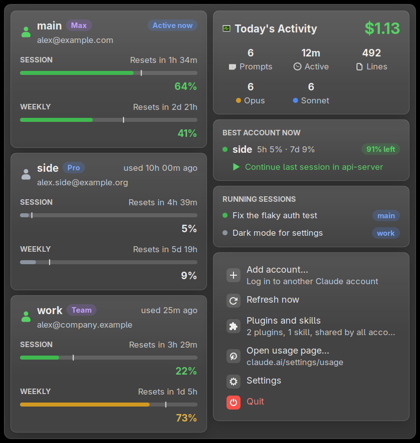
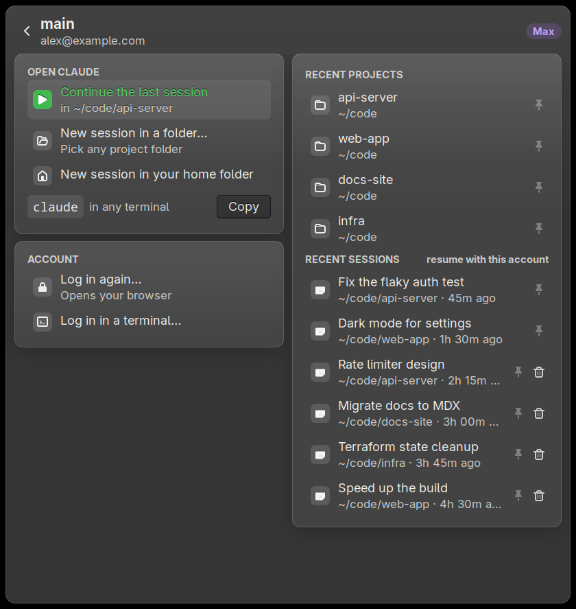

# claude-accounts

Several Claude Code accounts on one Linux machine, working as one. Every account shares the same history, sessions, settings, plugins and skills: start a session on one account, and when it reaches its limit, continue it on another. A panel icon shows how much of each account's 5-hour and weekly limits is left.

<p align="center"></p>

## Install

```sh
curl -fsSL https://raw.githubusercontent.com/anil0403/claude-accounts/main/install.sh | bash
```

or from a clone:

```sh
git clone https://github.com/anil0403/claude-accounts && cd claude-accounts && ./install.sh
```

The installer sets up everything in one pass:
- installs anything missing (jq, GTK for Python, an AppIndicator library where the panel needs one) with pacman, apt, dnf or zypper
- installs the program into `~/.local/share/claude-accounts` and the commands into `~/.local/bin`
- configures the status line, adds the app menu entry and starts the tray at login

Running it again updates in place. You need Claude Code. If it isn't installed yet, install it first with `curl -fsSL https://claude.ai/install.sh | bash`.

## Use

```sh
claude-acc add work        # create the account "work" and log it in (your browser opens)
claude-work                # Claude Code on that account, in any folder
claude-work --continue     # continue the last session of this folder, whichever account started it
claude-acc list            # every account: who it is logged in as, plan, usage
```

Plain `claude` stays your first account, called **main**. Each account you add gets its own `claude-<name>` command.

Hit a limit mid-task? Quit and run `claude-<other> --continue` in the same folder, or use `--resume` to pick any session. The conversation goes on with the other account.

### The panel icon

The ring shows the 5-hour usage of the account you used last: green, then amber from 70% and red from 90%, grey when the numbers are old. Click it for the dashboard:

- **Accounts** (left): the 5-hour and weekly bars for each one. The tick on a bar is where you would be if you spent evenly, so a bar past its tick runs out early.
- **Today's Activity:** prompts, active time, lines written and the cost at API prices, across all accounts.
- **Best account now:** the one with the most room left. Click it to continue your last session on it.
- **Running sessions:** open Claude Code sessions and the account each one uses.



Click an account to:
- continue the last session or start one in any folder
- resume any recent session with that account (pin the ones you use most)
- log the account in again or remove it

Below them: add an account, refresh, open the usage page, and the settings:
- what the panel text shows
- usage alerts at 80% and 95%
- hiding email addresses
- starting at login

Plugins and skills lists what is installed. Everything there is shared by every account.

The icon works with Cinnamon, MATE and Xfce through XApp; KDE, GNOME with the AppIndicator extension and others through an AppIndicator; and any other X11 panel through the classic tray. On Wayland it runs through XWayland.

<br clear="right">

### The status line

Claude Code's status line becomes three lines: model, account, context, folder and branch, then each limit with its reset time.

```
Opus 5.5 │ ◉ work │ ◔ 23% │ my-project (main) │ ● thinking
current  ●●●○○○○○○○ 28%   ⟳ 7:00pm
weekly   ●●●●●●●●○○ 79%   ⟳ mar 10, 10:00am
```

It also records each account's usage for the tray and `claude-acc list`, so they rarely need to ask the usage API. If you already had a status line, the installer keeps it. Yours still draws, and the usage is recorded alongside it. It runs in about 15 ms.

## What is shared

| Shared by all accounts (links into `~/.claude`) | Kept per account (`~/.claude-accounts/<name>`) |
|---|---|
| history, sessions and their files, plans, todos | the login (`.credentials.json`) |
| `settings.json`, `CLAUDE.md` (memory), keybindings | `.claude.json` (account and per-project state) |
| skills, agents, commands, plugins, hooks, output styles | Remote Control and background jobs |

The list of shared items is fixed, so anything Claude Code adds in the future stays per account until it's known to be safe to share.

Skills or plugins you add to a single project can be shared with every project as well. The installer turns this on: `claude-acc share` runs at every session start. To turn it off, run `claude-acc share --no-auto`.

## Commands

| | |
|---|---|
| `claude-acc add <name> [--email you@example.com]` | create an account and its `claude-<name>` command, then log it in |
| `claude-acc login <name>` | log an account in again |
| `claude-acc list` | accounts, logins, plans, usage |
| `claude-acc run <name> [args]` | same as `claude-<name> [args]` |
| `claude-acc rm <name>` | log out and remove an account (shared history stays) |
| `claude-acc sync` | re-link the shared files and rewrite the commands |
| `claude-acc share [--auto \| --no-auto]` | share project skills/plugins with every project |
| `claude-acc doctor` | check the setup and say what to fix |
| `claude-acc uninstall` | remove claude-accounts |
| `claude-tray [--background \| --test]` | the panel icon; `--test` prints what it would show |

## Privacy

Everything stays on your machine. When an account's numbers are more than 5 minutes old, the tray asks Anthropic's usage API, using that account's own login token. It sends nothing anywhere else. You can turn this off in the settings.

## Uninstall

```sh
claude-acc uninstall
```

This removes the program, the menu entry, autostart and the auto-share hook, and gives back your previous status line. Your accounts, their `claude-<name>` commands, your history and your settings are kept. To remove an account as well, run `claude-acc rm <name>` first.

## Troubleshooting

- `claude-acc doctor` checks the setup and says what to fix.
- If the tray misbehaves, see its log at `~/.cache/claude-tray/tray.log`.
- To pick a terminal, set `CLAUDE_TRAY_TERMINAL` (kitty, gnome-terminal, konsole, alacritty, wezterm, foot, tilix, xfce4-terminal or xterm). Otherwise the first one installed is used.

## Development

```sh
python3 -m unittest discover -s tests   # the tray's data code
tests/install-test.sh                   # install, use and uninstall in a throwaway HOME
tests/bench.sh                          # status line speed (budget 50 ms)
tests/preview.sh                        # status line at several widths
tests/demo.sh                           # the dashboard on made-up data
```

## License

MIT. claude-accounts is an independent project and is not affiliated with or endorsed by Anthropic. Claude and Claude Code are trademarks of Anthropic.
